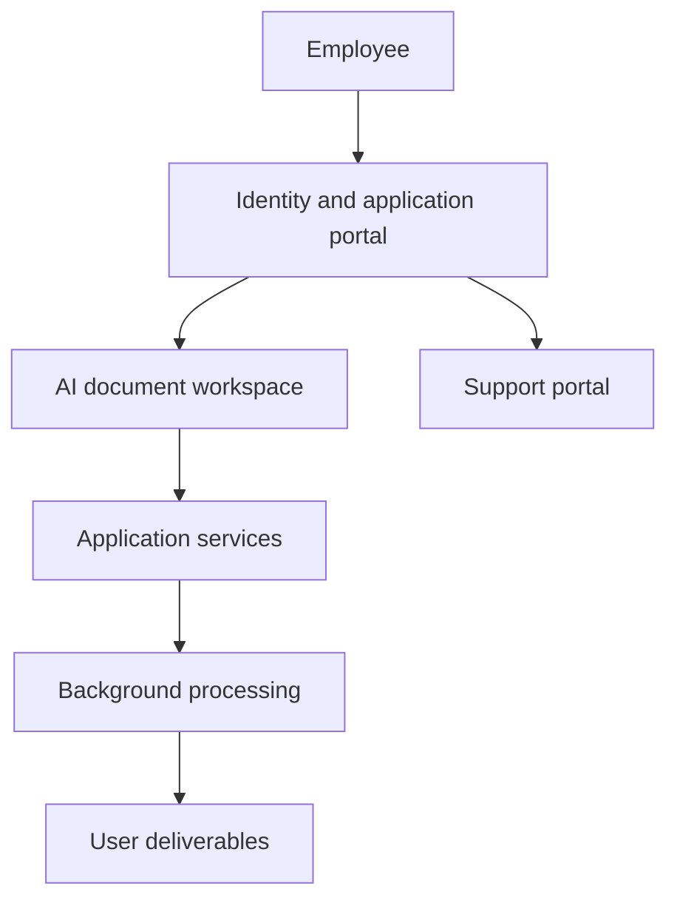

# MIA Apps — Enterprise AI Application Suite — Architecture

Employees access several document-oriented applications through a common entry point. The suite brings together identity and application access, audio transcription, PDF text extraction, assisted document preparation and support documentation, while keeping the individual applications organized as separate components.

## Components

| Component | Responsibility |
|---|---|
| Identity portal | Authentication, user session and controlled routing to applications. |
| AI workspace | React interface and Python services for document-processing tools. |
| Background workers | Long-running processing separated from interactive requests. |
| Application data and private files | Persistent job records, metadata and user-owned deliverables. |
| Support portal | Documentation, tutorials and IT guidance. |
| Parent repository | Integrates independently maintained application projects through Git subtrees. |

## Main interactions

## Responsibility boundaries

- Share identity while keeping applications distinct. Users have a consistent entry point without merging every application’s business model.
- Move document processing into background jobs. Long operations can expose progress and results without blocking navigation.
- Integrate child projects through a parent repository. The suite can be maintained as a whole while child applications retain their own repositories.

## Constraints

A shared portal does not make application data interchangeable; identity, document ownership and application-specific processing remain separate concerns.

## Technology

React, JavaScript/TypeScript, Python, FastAPI, PostgreSQL, background workers, Docker and Git subtrees.
